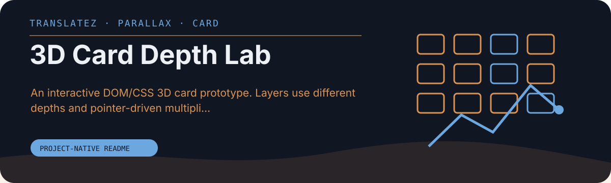
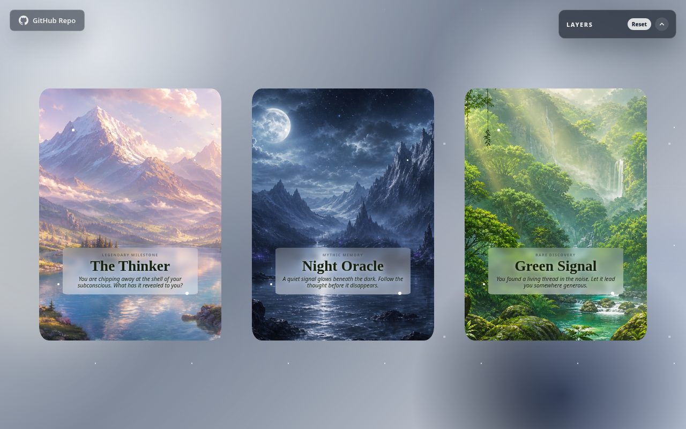
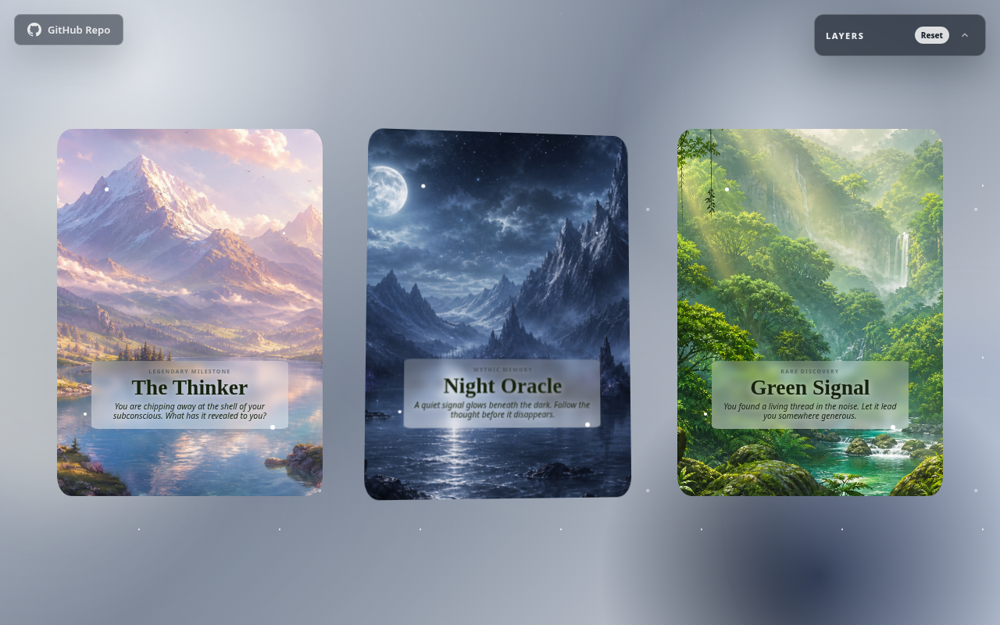

<p align="right"><a href="README.md">中文</a></p>

<p align="center">
  
</p>

<p align="center">
  <a href="https://xiaosang.cc/card-3d-depth-lab/">▶ Play Online</a>
  ·
  <a href="https://holynova.github.io/card-3d-depth-lab/">GitHub Pages mirror</a>
  ·
  <a href="https://github.com/holynova/card-3d-depth-lab">GitHub Repository</a>
</p>

3D Card Depth Lab is a pure DOM/CSS 3D card experiment: 3 cards (alpine The Thinker, moonlit Night Oracle, rainforest Green Signal), each built from 12 layers at different `translateZ` depths. Move the pointer and the card tilts — layers shift by depth, producing real parallax. Double-click to flip to the card back; the layers panel toggles each layer and its opacity.

## Screenshots

<p align="center">
  
</p>

<p align="center">
  
</p>

## Interactions

- **Pointer tilt**: each card tracks the pointer independently — `rotateY` ±13°, `rotateX` ∓11° at 1400px perspective; springs back on leave.
- **Double-click to flip**: `rotateY(180°)` reveals the card back (a moon-phase star chart); double-click again to flip back.
- **Layers panel**: every layer gets a toggle + opacity slider, with one-click Reset to restore defaults; auto-collapses on narrow screens (≤900px).

## Layers & Depths

| Depth | Layer | Default |
|---|---|---|
| 0 | 底板 Base (with grain) | On |
| 8 | 图片 Image | On |
| 22 | 箔光 Foil | Off |
| 24 | 边框 / 角标 Border / corner marks | Off |
| 30 | 页脚条 Footer strip | Off |
| 32 | 印章 Seal | Off |
| 34 | 文案 Copy (kicker / title / subtitle) | On |
| 36 | 花簇 Flowers | Off |
| 42 | 星光 Sparkles | On |
| — | 卡背 Card back (separate face) | On |

## The Three Cards

| Card | Kicker | Attribute | Rarity |
|---|---|---|---|
| The Thinker | LEGENDARY MILESTONE | +150 Tranquility | L |
| Night Oracle | MYTHIC MEMORY | +90 Clarity | M |
| Green Signal | RARE DISCOVERY | +120 Vitality | R |

## Measured Proportions

Card ratio and type sizes were measured from a reference screenshot (see `REFERENCE_MEASUREMENTS.md`): aspect ratio `547 / 756`, type sized in container units `cqw` (title 8.1cqw, subtitle 3.05cqw, kicker 2.05cqw, footer 2.75cqw) — on a 360px-wide card the title is about 29.2px.

## Run Locally

```bash
npm install
npm run dev     # vite dev
npm run build   # build output goes to docs/ (GitHub Pages source)
```

## Tech

- Vite + vanilla JS + CSS, zero runtime dependencies (Vite is the only dependency).
- `transform-style: preserve-3d` + `perspective: 1400px`; pointer position flows into CSS variables `--mx` / `--my` / `--rx` / `--ry`, and tilt and parallax are pure CSS.

```
index.html          Entry (#app is rendered by main.js)
src/main.js         Card data / layers panel / pointer tilt / double-click flip
src/styles.css      3D scene, layer depths, card typography (cqw units)
public/assets/      4 card artworks (alpine / moonlit / rainforest / card back)
REFERENCE_MEASUREMENTS.md   Measured reference sizes and their CSS mapping
docs/               Build output (GitHub Pages source)
```
