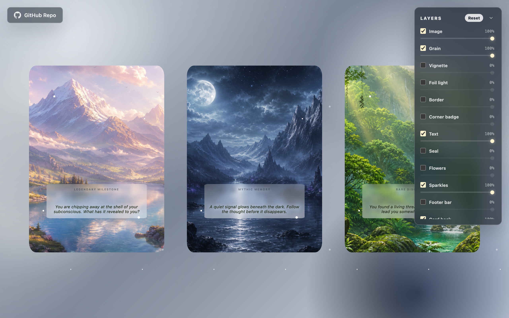

# 3D Card Depth Lab

An interactive DOM/CSS 3D card prototype. Layers use different `translateZ(...)` depths and pointer-driven `translate3d(...)` multipliers to create an immersive parallax effect.

## Links

- **GitHub Repository**: [github.com/holynova/card-3d-depth-lab](https://github.com/holynova/card-3d-depth-lab)
- **Live Demo**: [holynova.github.io/card-3d-depth-lab](https://holynova.github.io/card-3d-depth-lab/)
- **Cloudflare Demo**: [card-3d-depth-lab.xiaosang.cc](https://card-3d-depth-lab.xiaosang.cc/)

## Screenshot



## Development

```bash
pnpm install
pnpm run dev
pnpm run build        # Cloudflare Static Assets -> dist/
pnpm run build:pages  # GitHub Pages -> docs/
```
