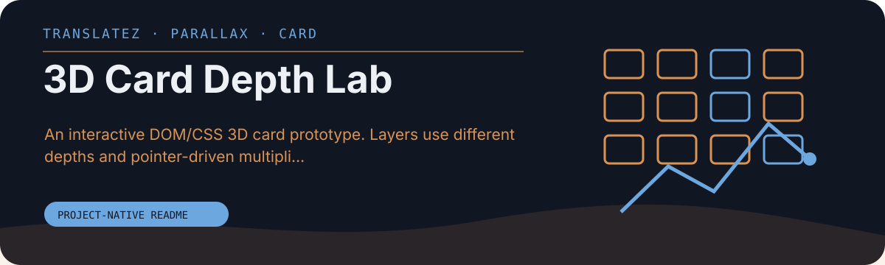
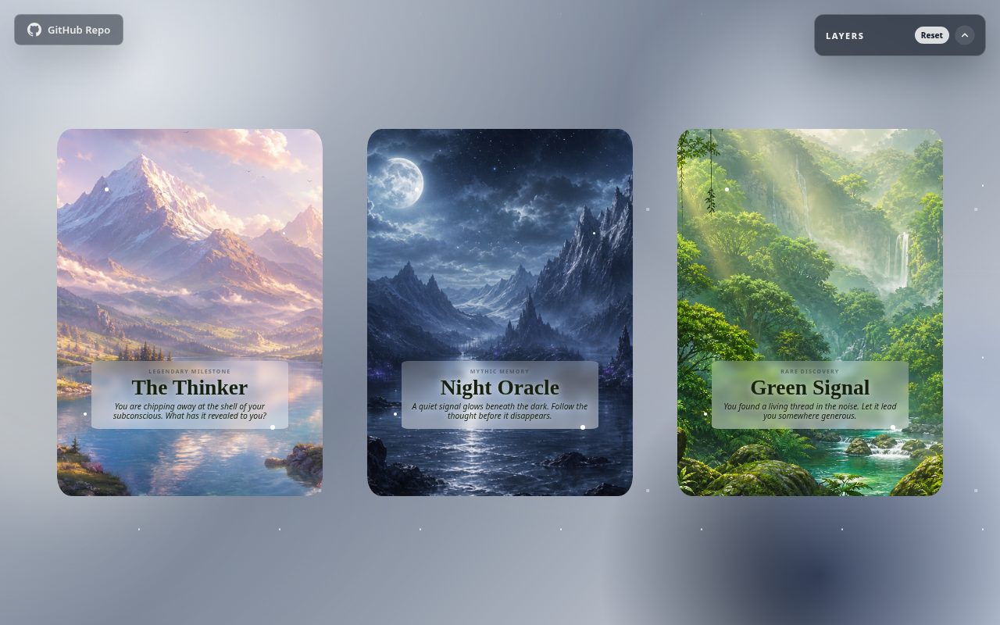

<p align="right"><a href="README.en.md">English</a></p>

<p align="center">
  
</p>

<p align="center">
  <a href="https://xiaosang.cc/card-3d-depth-lab/">▶ 在线体验</a>
  ·
  <a href="https://holynova.github.io/card-3d-depth-lab/">GitHub Pages 备选镜像</a>
  ·
  <a href="https://github.com/holynova/card-3d-depth-lab">GitHub 仓库</a>
</p>

3D Card Depth Lab 是纯 DOM/CSS 的 3D 卡片实验：3 张卡（雪山 The Thinker、月夜 Night Oracle、雨林 Green Signal），每张由 12 个图层叠成，各站一个 `translateZ` 深度。指针在卡上移动时整张卡倾斜，图层按深度错动产生视差；双击翻牌看卡背；右侧图层面板可开关每一层、调透明度。

## 截图

<p align="center">
  
</p>

<p align="center">
  
</p>

## 交互

- **指针倾斜**：每张卡独立感应指针位置，`rotateY` ±13°、`rotateX` ∓11°，透视 1400px；指针离开回正。
- **双击翻牌**：`rotateY(180°)` 翻到卡背（月相星图），再双击翻回。
- **图层面板**：12 个图层各有开关 + 透明度滑杆，一键 Reset 恢复默认；窄屏（≤900px）自动收起。

## 图层与深度

| 深度 | 图层 | 默认 |
|---|---|---|
| 0 | 底板（含颗粒） | 开 |
| 8 | 图片 | 开 |
| 22 | 箔光 | 关 |
| 24 | 边框 / 角标 | 关 |
| 30 | 页脚条 | 关 |
| 32 | 印章 | 关 |
| 34 | 文案（眉题 / 标题 / 副标题） | 开 |
| 36 | 花簇 | 关 |
| 42 | 星光 | 开 |
| — | 卡背（独立面） | 开 |

## 三张卡

| 卡 | 眉题 | 属性 | 稀有度 |
|---|---|---|---|
| The Thinker | LEGENDARY MILESTONE | +150 Tranquility | L |
| Night Oracle | MYTHIC MEMORY | +90 Clarity | M |
| Green Signal | RARE DISCOVERY | +120 Vitality | R |

## 尺寸考据

卡片比例与字号按参考截图实测（见 `REFERENCE_MEASUREMENTS.md`）：宽高比 `547 / 756`，字号用容器单位 `cqw`（标题 8.1cqw、副标题 3.05cqw、眉题 2.05cqw、页脚 2.75cqw），360px 宽的卡标题约 29.2px。

## 本地运行

```bash
npm install
npm run dev     # vite dev
npm run build   # 构建产物输出到 docs/（GitHub Pages 发布源）
```

## 技术

- Vite + 原生 JS + CSS，零运行时依赖（vite 是唯一依赖）。
- `transform-style: preserve-3d` + `perspective: 1400px`；指针位置写入 CSS 变量 `--mx` / `--my` / `--rx` / `--ry`，倾斜与视差全由 CSS 完成。

```
index.html          入口（#app 由 main.js 渲染）
src/main.js         卡片数据 / 图层面板 / 指针倾斜 / 双击翻牌
src/styles.css      3D 场景、图层深度、卡片排版（cqw 单位）
public/assets/      4 张卡面原画（雪山 / 月夜 / 雨林 / 卡背）
REFERENCE_MEASUREMENTS.md   参考截图实测尺寸与 CSS 映射
docs/               构建产物（GitHub Pages 发布源）
```
